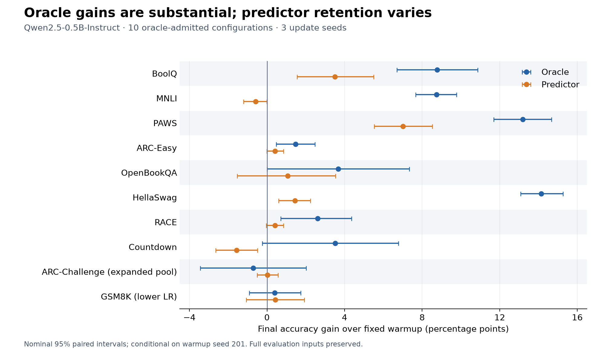

# Oracle Gains and Predictor Retention: 13 Benchmarks

**Qwen2.5-0.5B-Instruct · October 10–11, 2026 · completed in under 14 hours**

> True-gradient oracle updates deliver substantial gains on several tasks. Predictors retain part of these gains, but their reliability and compute advantage remain unresolved.

**13 benchmarks → 10 oracle-admitted configurations → 7 with positive final mean gains for both oracle and predictor.**

## Final results

Gains are accuracy **percentage points relative to the same fixed warmup**. Admitted configurations use three update seeds. Selection used development and confirmation data; final results did not determine the recipes below.

| Benchmark / configuration | Warmup (%) | Oracle gain (pp) | Predictor gain (pp) | Predictor |
|---|---:|---:|---:|---|
| BoolQ | 64.32 | +8.77 | +3.50 | CV4 |
| MNLI | 71.42 | +8.73 | -0.58 | Adaptive |
| PAWS | 72.67 | +13.18 | +7.01 | CV4 |
| ARC-Easy | 71.09 | +1.47 | +0.42 | Adaptive |
| OpenBookQA | 57.00 | +3.67 | +1.07 | Frozen / global fit |
| HellaSwag | 41.91 | +14.14 | +1.45 | Frozen |
| RACE | 60.84 | +2.61 | +0.41 | Adaptive |
| Countdown | 8.59 | +3.52 | -1.56 | Adaptive |
| ARC-Challenge (expanded pool) | 52.13 | -0.71 | +0.03 | Frozen |
| GSM8K (lower LR) | 47.84 | +0.40 | +0.43 | Adaptive |
| SVAMP † | 65.67 | -2.00 | — | Not run |
| AQuA † | 32.28 | -9.84 | — | Not run |
| MATH-500 † | 31.60 | +0.60 | — | Not run |

† Single update seed. These configurations failed development screening and did not proceed to predictor training. MATH-500 is the evaluation set for MATH training. ARC-Challenge and GSM8K show their admitted supplemental recipes; **all 18 configurations**, including their original failures, are retained in [the detailed results](DETAILS.md#all-18-configurations).

## What we learned

- **Oracle gains are substantial on several tasks.** BoolQ, MNLI, PAWS, and HellaSwag improve by about 9–14 points on average across three update seeds.
- **Predictor retention is partial and task-dependent.** BoolQ retains about **40%** of its oracle gain; PAWS about **53%**; HellaSwag about **10%**. MNLI and Countdown lose accuracy with the selected predictor.
- **Bigger learning rates are not always better.** GSM8K improves from **42.91% to 48.24%** when the oracle recipe changes from `3e-4 × 8 steps` to `1e-5 × 32 steps`. Both learning rate and stopping changed. The revised result remains below the base model's **48.98%**.
- **Predictors need their own learning-rate and stopping search.** Copying oracle settings often failed in development experiments.
- **Accuracy retention does not establish compute savings.** BoolQ and PAWS use four true-gradient examples per step (CV4). Neither establishes an advantage over suitably tuned small-batch true-gradient controls. The selected GSM8K predictor uses **2.5×** the online true-gradient example exposures of its selected oracle.

## How to interpret this study

- **Warmup is one seed (201), not a multi-seed average.** The three update seeds are 101/102/103; predictor fit seeds are 123/124/125. Each task uses its own fixed warmup.
- **Admission means positive three-seed mean gain on development and confirmation**, with no per-seed or confidence-interval threshold. Positive final means count as gains under the study rule, but some gains are small and uncertain.
- **Full evaluation inputs were preserved.** Output caps limit generated tokens only: 256 for short answers and 2,048 for mathematical tasks, AQuA, and Countdown.
- **Final evaluation is exploratory.** Some legacy evaluation sets had been inspected in earlier studies. Confidence intervals are conditional on the fixed warmup. Development success did not guarantee final success: ARC-Challenge's expanded-pool oracle declined on final evaluation.

## Files

| File | Contents |
|---|---|
| [Detailed results and settings](DETAILS.md) | All 18 configurations, actual learning rates / steps, methods, controls, and limitations |
| [Summary CSV](summary.csv) | 18 configurations, base/warmup/final accuracy, gains, and nominal 95% intervals |
| [Per-variant CSV](final_variants.csv) | All 156 final variants, individual seeds, and full-set / source-disjoint scores |
| [Selected recipes](selected_recipes.json) · [Protocol](protocol.json) | Settings, seeds, adapter hashes, and search grids |
| [Task audits](task_audits.json) · [Provenance](provenance.json) | Audited statistics, prediction hashes, and original source-file hashes |
| [All-configuration plot](all_configurations.pdf) | Oracle and predictor gains for every completed configuration |

The original study checked **591,561 raw predictions** across **156 variants**. This compact release contains the results and configurations; datasets, raw generations, model weights, and offline caches remain outside Git. Plot regeneration: `python render_overview.py` (requires Matplotlib).
