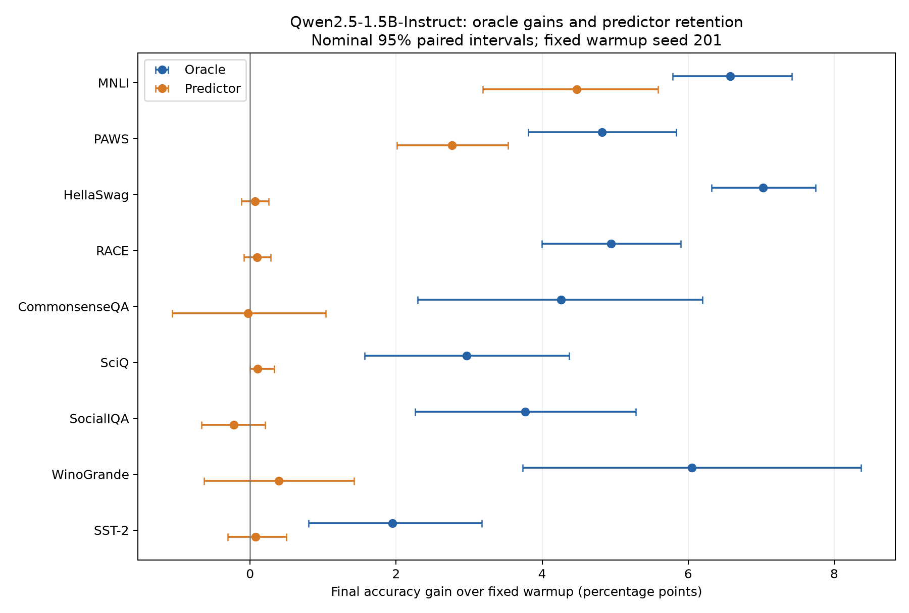

# 1.5B: Oracle Gains and Predictor Retention

**Qwen2.5-1.5B-Instruct · 9 benchmarks · 3 update seeds · October 11–12, 2026**

- **Oracle works across all nine benchmarks:** final gains of **+1.95 to +7.03 percentage points**, with positive 95% intervals.
- **Predictor retention is limited:** **68% on MNLI**, **57% on PAWS**; gains on the other seven tasks remain uncertain.
- **No established advantage over true-gradient controls:** the MNLI/PAWS predictors use four true-gradient examples per step (CV4), and their updates take about **2.3× as long** as the four-example oracle controls.

## Final results

Accuracy gains in **percentage points over the same fixed warmup**, averaged over three update seeds.

| Benchmark | Oracle gain | Predictor gain | Oracle gain retained |
|---|---:|---:|---:|
| MNLI | +6.57 | +4.47 | 68.0% |
| PAWS | +4.82 | +2.76 | 57.3% |
| HellaSwag | +7.03 | +0.07 | 0.9% |
| RACE | +4.95 | +0.09 | 1.9% |
| CommonsenseQA | +4.26 | -0.03 | -0.6% |
| SciQ | +2.97 | +0.10 | 3.4% |
| SocialIQA | +3.77 | -0.22 | -5.9% |
| WinoGrande | +6.05 | +0.39 | 6.5% |
| SST-2 | +1.95 | +0.08 | 3.9% |

Retention percentages are point estimates. Only MNLI and PAWS have predictor gain intervals strictly above zero; their CV4-versus-true-gradient-control intervals include zero.

## Read more

- [Exact LR/step settings, controls, 0.5B comparison and limitations](DETAILS.md).
- [Summary with confidence intervals](summary.csv) · [All 127 final variants](final_variants.csv).
- [Selected recipes](selected_recipes.json) · [Protocol](protocol.json) · [Prompt templates](prompt_templates.json).
- [Audits](audit_summary.json) · [Provenance and source hashes](provenance.json).

Recipes were selected on development/confirmation data and frozen before final readout. Each task uses **one fixed warmup seed (201)**; intervals are conditional on that warmup. Full inputs were preserved; **256 new tokens caps output generation only**. All update methods use labeled training examples.

Completed within the 11-hour budget, with **680,123 predictions verified** and GPU resources released. This compact release contains results and configuration metadata; datasets, raw generations, checkpoints and caches remain in the local archive.
