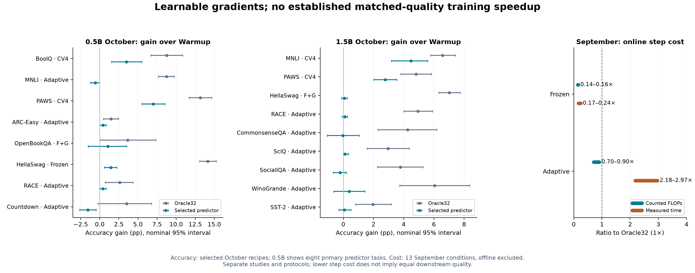

# LoRA gradient prediction: results across 0.5B, 1.5B and 7B

**Evidence through October 12, 2026 · consolidated October 13 · Qwen2.5-Instruct**

[Project](../../README.md) · [Exact settings](recent_selected_settings.csv) · [All October methods](METHODS.md) · [Benchmark data](benchmark_summary.csv) · [Costs](recent_costs.csv)

**Gradients are learnable; a reliable training-efficiency advantage is not established.** Frozen prediction is cheap online but can drift and collapse. Adaptive calibration can prevent collapse but is expensive. CV4 produces useful gains on a few tasks, without an established advantage over small-batch true-gradient updates.

## Coverage and reading guide

| Model | Evaluated task coverage | Main evidence |
|---|---|---|
| 0.5B | 13 tasks | October benchmark screening; predictors on 10 admitted configurations across 10 tasks; earlier Countdown studies |
| 1.5B | 18 tasks | 9 September tasks + 9 October tasks; separate Oracle, data-scale and long-run follow-ups |
| 7B | 5 tasks | Countdown, GSM8K, MATH, AQuA, ARC-Challenge; no corresponding CV4 benchmark study recorded |

**Base** = unadapted model; **Warmup** = common true-gradient starting checkpoint; **Oracle32** = true gradients on all 32 update examples. Accuracy is **%**; gains are **percentage points**. A positive point estimate does not establish a reliable improvement. Studies have different prompts, scoring, warmups and budgets: compare methods within a study, not absolute scores across studies. MATH-500 and full-MATH are evaluation populations of the same task; ARC difficulties are two task configurations, not independent domains.

## 0.5B: October 10 benchmark study

Development-selected predictor recipes; three update seeds where admitted. **†** denotes a single-seed Oracle screen; predictor not run. BoolQ uses the predeclared 2,713-question source-disjoint subset (full 3,270-question results also retained).

| Task | N | Base | Warmup | Oracle32 | Predictor | Method | P − W |
|---|---|---|---|---|---|---|---|
| BoolQ | 2713 | 66.68 | 64.32 | 73.09 | 67.82 | CV4 | +3.50 |
| MNLI | 9815 | 39.01 | 71.42 | 80.16 | 70.84 | Adaptive | -0.58 |
| PAWS | 8000 | 33.98 | 72.67 | 85.86 | 79.69 | CV4 | +7.01 |
| ARC-Easy | 2376 | 50.04 | 71.09 | 72.56 | 71.51 | Adaptive | +0.42 |
| OpenBookQA | 500 | 42.40 | 57.00 | 60.67 | 58.07 | Frozen + Globalfit | +1.07 |
| HellaSwag | 10042 | 20.18 | 41.91 | 56.06 | 43.36 | Frozen | +1.45 |
| RACE | 4934 | 56.89 | 60.84 | 63.45 | 61.26 | Adaptive | +0.41 |
| ARC-Challenge † | 1172 | 34.47 | 52.13 | 52.47 | — | Not run | — |
| SVAMP † | 300 | 61.00 | 65.67 | 63.67 | — | Not run | — |
| AQuA † | 254 | 32.28 | 32.28 | 22.44 | — | Not run | — |
| GSM8K | 1319 | 48.98 | 47.84 | 42.91 | — | Not run | — |
| Countdown | 2048 | 4.20 | 8.59 | 12.11 | 7.03 | Adaptive | -1.56 |
| MATH-500 † | 500 | 31.40 | 31.60 | 32.20 | — | Not run | — |

All five completed supplemental configurations — including unsuccessful ones

| Task | N | Base | Warmup | Oracle32 | Predictor | Method | P − W |
|---|---|---|---|---|---|---|---|
| ARC-Challenge (expanded pool) | 1172 | 34.47 | 52.13 | 51.42 | 52.16 | Frozen | +0.03 |
| SVAMP (lower LR) † | 300 | 61.00 | 65.67 | 63.00 | — | Not run | — |
| AQuA (answer only) † | 254 | 34.25 | 37.01 | 33.86 | — | Not run | — |
| GSM8K (lower LR) | 1319 | 48.98 | 47.84 | 48.24 | 48.27 | Adaptive | +0.43 |
| MATH-500 (lower LR) † | 500 | 31.40 | 31.60 | 33.00 | — | Not run | — |

ARC-Challenge expanded-pool and GSM8K lower-LR recipes were admitted on development/confirmation, then evaluated; they are not additional datasets. The original failures above remain visible. All 18 completed configurations are in the CSV.

CV4 improves BoolQ/PAWS over Warmup; Frozen improves HellaSwag. Other positive predictor means are uncertain. Improvements over Warmup alone do not show superiority to Oracle4 or to Base: BoolQ's Warmup itself is below Base.

[Original report, intervals and protocol](../benchmark_0p5b_20261010/README.md) · [Every final variant and seed](recent_final_variants.csv)

## 1.5B: October 11–12 benchmark study

Three paired update seeds, one fixed warmup per task. All nine Oracle gains have positive recorded family-adjusted intervals. Only MNLI/PAWS have clearly positive selected-predictor gains; the other seven predictor intervals include zero.

| Task | N | Base | Warmup | Oracle32 | Predictor | Method | P − W |
|---|---|---|---|---|---|---|---|
| MNLI | 9815 | 65.36 | 78.24 | 84.81 | 82.71 | CV4 | +4.47 |
| PAWS | 8000 | 77.59 | 84.39 | 89.21 | 87.15 | CV4 | +2.76 |
| HellaSwag | 10042 | 64.10 | 72.85 | 79.88 | 72.92 | Frozen + Globalfit | +0.07 |
| RACE | 4934 | 75.68 | 76.25 | 81.19 | 76.34 | Adaptive | +0.09 |
| CommonsenseQA | 1221 | 71.17 | 74.20 | 78.46 | 74.17 | Adaptive | -0.03 |
| SciQ | 1000 | 88.50 | 88.60 | 91.57 | 88.70 | Adaptive | +0.10 |
| SocialIQA | 1954 | 67.14 | 68.63 | 72.40 | 68.41 | Adaptive | -0.22 |
| WinoGrande | 1267 | 56.04 | 59.43 | 65.48 | 59.83 | Adaptive | +0.39 |
| SST-2 | 872 | 90.71 | 92.66 | 94.61 | 92.74 | Adaptive | +0.08 |

MNLI uses **Globalfit + CV4**; PAWS uses the original predictor + CV4. They retain 68% and 57% of Oracle gains, respectively. These are gains relative to Warmup, not claims of matched-quality efficiency.

[Original report and intervals](../benchmark_1p5b_20261011/README.md) · [Data splits and prompt settings](../benchmark_1p5b_20261011/benchmark_data_summary.csv)

## Earlier 1.5B / 7B: independently tuned method comparisons

September 30 study: **32 updates, primary fit/update seed 123/101**. Each column uses its own development-selected LR. This shows Frozen, Adaptive and Periodic8 separately; it does **not** replace the original development-selected predictor strategy with the highest final-test score. The original strategy improves on Warmup in 4/13 conditions; Adaptive alone has positive point estimates in 9/13, but no Adaptive–Warmup or Adaptive–Oracle comparison survives its 13-comparison Holm correction.

### 1.5B: nine earlier tasks

| Task | N | Base | Warmup | Oracle32 | Frozen | Adaptive | Periodic8 |
|---|---|---|---|---|---|---|---|
| Countdown | 2048 | 10.45 | 11.87 | 10.21 | 9.47 | 10.11 | 10.25 |
| SVAMP | 300 | 87.33 | 83.33 | 84.00 | 84.67 | 84.00 | 84.33 |
| AQuA | 254 | 55.51 | 56.30 | 55.51 | 54.72 | 53.94 | 53.15 |
| GSM8K | 1319 | 73.09 | 74.22 | 74.60 | 73.77 | 73.46 | 73.54 |
| MATH-500 | 500 | 56.00 | 56.60 | 56.60 | 56.20 | 57.20 | 55.60 |
| ARC-Easy | 2376 | 87.42 | 88.05 | 88.43 | 87.96 | 88.38 | 88.13 |
| ARC-Challenge | 1172 | 73.63 | 72.95 | 73.29 | 72.87 | 73.21 | 72.95 |
| OpenBookQA | 500 | 73.60 | 76.20 | 78.00 | 76.80 | 77.40 | 76.20 |
| BoolQ | 3270 | 77.83 | 78.99 | 78.84 | 78.90 | 79.02 | 78.90 |

### 7B: all five tasks

| Task | N | Base | Warmup | Oracle32 | Frozen | Adaptive | Periodic8 |
|---|---|---|---|---|---|---|---|
| Countdown | 2048 | 37.40 | 37.21 | 37.01 | 37.26 | 36.91 | 36.87 |
| GSM8K | 1319 | 91.66 | 91.51 | 91.43 | 91.96 | 92.04 | 91.51 |
| AQuA | 254 | 77.17 | 77.17 | 76.77 | 81.50 | 79.92 | 78.35 |
| ARC-Challenge | 1172 | 90.27 | 89.93 | 89.85 | 89.85 | 90.02 | 89.85 |
| MATH-500 * | 500 | 76.40 | 78.40 | 77.80 | 77.40 | 77.60 | — |

*MATH note:* this row is from the September 26 **gentle-warmup** experiment: 32 updates, primary seed, with Oracle/Frozen at the same LR as Adaptive (not independently selected). Its three-seed Adaptive mean is 77.80%; Adaptive–Warmup and Adaptive–Mean intervals both include zero. Full-MATH (4,999 nonoverlapping questions) gives Warmup 75.22%, Adaptive 75.30%, Mean 75.28%; no clear extra benefit.

For 1.5B full-MATH under that earlier protocol, Warmup is 52.15%, Adaptive 49.27%, Mean 49.69%. The population includes MATH-500 and is not an independent replication. Different MATH protocols should not be merged.

[September method comparisons and statistical scope](../../predictor/countdown_predictor_results/scaling-domains-20260930/README.md) · [September 26 original/gentle results and repeated seeds](../../predictor/countdown_predictor_results/scaling-benchmarks-20260926/README.md) · [All 52 overview configurations](benchmark_summary.csv)

## What the methods mean

| Method / modification | What changes | Evidence so far |
|---|---|---|
| Frozen | Fit predictor offline; no online backbone backward | Cheap online; occasional short-run gains; long-run drift |
| Adaptive | Refresh true gradients for 4 current + 16 selection examples; train/select predictor each step | Can prevent collapse; no stable cross-task incremental benefit; high runtime |
| Periodic8 / fixed calibration | Calibrate less often or for a fixed number of epochs | Tested cost/stability compromises; no established general advantage |
| CV4 | Predict batch gradients, correct with true-minus-predicted gradients on 4 examples; predictor frozen online | Useful MNLI/PAWS/BoolQ gains; must beat Oracle4, not just Warmup |
| Globalfit | Replace per-example gradient-energy denominators with fixed training-set A/B scales; change checkpoint metric too | Helps some fits; e.g. 0.5B OpenBookQA Frozen 50.07% → 58.07%, Warmup 57%; LR also retuned |
| Batchfit | Add error on the aggregate batch gradient and use it in checkpoint selection | BoolQ aggregate alignment improved without a demonstrated downstream gain |
| Other tested changes | X vs Y, labels/masks/position, residual features, larger networks, multi-state supervision, multiple layers, history carry/reset, feedback and learned preconditioning | Static improvements do not consistently transfer to downstream accuracy; protocols differ |
| Mean / MeanM controls | Fresh small-sample mean / fixed offline dense gradient matrix | Frequently competitive; separate predictor benefit from common gradient direction |

Early direct-gradient work also tested Ridge, MLP, low-rank bottlenecks, pooling, layers/modules/ranks and target-alignment ranking. These are gradient/data-selection studies, not the same downstream training experiment. [Early methods](../../predictor/single_layer/README.md) · [Countdown history](../../predictor/countdown_predictor_results/HISTORY.md)

## Does CV4 beat Oracle4?

Three paired seeds. Differences are **CV4 − Oracle4** with nominal seed/source-group 95% intervals, conditional on fixed warmup and selected recipes; they are not equivalence/noninferiority tests.

**Independently tuned** lets Oracle4 choose its own LR and stopping step on development data. **Matched to CV4** fixes those choices to CV4's selected recipe. The first compares practical methods after tuning; the second isolates the update rule under the same settings. Oracle4 uses only four true gradients per update in both cases.

| Model / task | Oracle4 settings | CV4 accuracy | Oracle4 accuracy | Difference [95% CI], pp | CV4 / O4 steps |
|---|---|---|---|---|---|
| 0.5B / BoolQ | Independently tuned | 67.82 | 67.43 | +0.39 [-0.28, +1.03] | 128 / 128 |
| 0.5B / PAWS | Independently tuned | 79.69 | 82.16 | -2.48 [-3.93, -1.12] | 128 / 256 |
| 0.5B / PAWS | Matched to CV4 | 79.69 | 75.67 | +4.01 [-1.60, +12.39] | 128 / 128 |
| 1.5B / MNLI | Independently tuned | 82.71 | 81.27 | +1.44 [-0.24, +3.02] | 256 / 256 |
| 1.5B / MNLI | Matched to CV4 | 82.71 | 81.42 | +1.29 [-0.61, +3.85] | 256 / 256 |
| 1.5B / PAWS | Independently tuned | 87.15 | 87.30 | -0.15 [-0.34, +0.04] | 256 / 256 |

0.5B PAWS's independently tuned Oracle4 uses twice as many online true-gradient examples; the matched 128-step comparison has large seed variation. All other rows match total online true-gradient exposures. Predictor offline supervision is additional. On 1.5B, mean paired CV4/Oracle4 online time is **2.35× on MNLI, 2.33× on PAWS**. No row establishes a positive CV4 advantage. [Exact comparisons](cv4_controls.csv) · [1.5B control timing](../benchmark_1p5b_20261011/four_gradient_control_costs.csv)

## Cost: online FLOPs and elapsed time

September 30 controlled profiling on H200; same initial state and main batch32, 2 warmups + 7 randomized timing repetitions. Each cell is **TFLOPs per step / seconds per step** (median time). Adaptive includes gradient-label collection, calibration and selection. **Offline preparation is excluded.** These are first-step profiles, not full-trajectory averages.

| Model / task | Oracle32 | Frozen | Adaptive |
|---|---|---|---|
| 1.5B / Countdown | 38.933 / 0.477 | 5.556 / 0.089 | 31.637 / 1.262 |
| 1.5B / SVAMP | 22.396 / 0.497 | 3.199 / 0.085 | 18.204 / 1.245 |
| 1.5B / AQuA | 53.316 / 0.560 | 7.680 / 0.107 | 39.517 / 1.280 |
| 1.5B / GSM8K | 53.556 / 0.506 | 7.666 / 0.098 | 44.307 / 1.356 |
| 1.5B / MATH-500 | 94.587 / 0.698 | 13.658 / 0.156 | 85.511 / 2.010 |
| 1.5B / ARC-Easy | 22.939 / 0.490 | 3.284 / 0.085 | 16.148 / 1.178 |
| 1.5B / ARC-Challenge | 22.400 / 0.492 | 3.207 / 0.084 | 19.246 / 1.175 |
| 1.5B / OpenBookQA | 16.054 / 0.471 | 2.293 / 0.082 | 12.778 / 1.142 |
| 1.5B / BoolQ | 45.782 / 0.507 | 6.560 / 0.093 | 39.191 / 1.295 |
| 7B / Countdown | 174.715 / 0.594 | 27.124 / 0.144 | 135.856 / 1.763 |
| 7B / GSM8K | 239.576 / 0.763 | 37.212 / 0.173 | 187.774 / 1.902 |
| 7B / AQuA | 238.066 / 0.777 | 37.033 / 0.180 | 168.026 / 1.694 |
| 7B / ARC-Challenge | 100.843 / 0.471 | 15.677 / 0.109 | 82.476 / 1.316 |

**Frozen:** 0.143–0.156× counted FLOPs and 0.171–0.242× time of Oracle32. **Adaptive:** 0.704–0.904× FLOPs but **2.18–2.97× time**. Less arithmetic did not imply lower latency. FLOPs count matrix/attention arithmetic (multiply-add = 2); some scalar, normalization, softmax, transfer and optimizer work is excluded. Offline FLOPs and 7B MATH profiling were not measured in this study. [All five methods and raw values](controlled_efficiency.csv)

Including offline collection/fitting, the original selected 32-step predictor strategies cost **3.37–19.68×** the same-LR Oracle across all 13 conditions. These are one-use adaptation costs, excluding common warmup; neither amortization nor matched quality is assumed. [Measured trajectories](../../predictor/countdown_predictor_results/scaling-domains-20260930/results/cost_amortization.csv)

October studies: all selected predictor trajectories and their actual time costs

Mean per run over available paired seeds. **O / P steps** may differ because methods select stopping independently. Oracle time is online; P total adds recorded offline collection + fitting to online updates. FLOPs were not profiled for these October benchmark recipes; the September ratios must not be transferred to them.

| Model / task | Predictor | O / P steps | Oracle online, s | P online, s | P setup + online, s |
|---|---|---|---|---|---|
| 0.5B / BoolQ | CV4 | 256 / 128 | 117.7 | 21.1 | 107.2 |
| 0.5B / MNLI | Adaptive | 256 / 8 | 109.1 | 5.8 | 84.2 |
| 0.5B / PAWS | CV4 | 256 / 128 | 116.0 | 19.8 | 99.6 |
| 0.5B / ARC-Easy | Adaptive | 8 / 8 | 3.8 | 6.2 | 46.5 |
| 0.5B / OpenBookQA | Frozen + Globalfit | 256 / 32 | 109.7 | 3.4 | 86.0 |
| 0.5B / HellaSwag | Frozen | 256 / 8 | 112.4 | 1.6 | 95.9 |
| 0.5B / RACE | Adaptive | 128 / 8 | 78.1 | 8.5 | 139.3 |
| 0.5B / Countdown | Adaptive | 256 / 8 | 118.1 | 6.5 | 96.1 |
| 0.5B / ARC-Challenge (expanded pool) | Frozen | 256 / 8 | 116.6 | 1.9 | 24.2 |
| 0.5B / GSM8K (lower LR) | Adaptive | 32 / 128 | 15.0 | 92.6 | 184.9 |
| 1.5B / MNLI | CV4 | 256 / 256 | 133.4 | 41.6 | 154.7 |
| 1.5B / PAWS | CV4 | 256 / 256 | 124.6 | 41.3 | 128.6 |
| 1.5B / HellaSwag | Frozen + Globalfit | 256 / 8 | 136.8 | 1.7 | 123.4 |
| 1.5B / RACE | Adaptive | 256 / 8 | 203.1 | 10.1 | 171.5 |
| 1.5B / CommonsenseQA | Adaptive | 256 / 128 | 132.6 | 96.5 | 188.5 |
| 1.5B / SciQ | Adaptive | 256 / 8 | 134.0 | 6.7 | 96.2 |
| 1.5B / SocialIQA | Adaptive | 128 / 32 | 65.3 | 25.1 | 113.6 |
| 1.5B / WinoGrande | Adaptive | 256 / 128 | 131.9 | 93.4 | 176.8 |
| 1.5B / SST-2 | Adaptive | 128 / 8 | 63.9 | 6.8 | 93.4 |

Common warmup, loading, search, generation evaluation and separate online audits are excluded; the recorded offline collector can include validation/diagnostic work. These observed timings are not proof of continuously exclusive GPU execution or production-optimal implementations. Faster trajectories with lower accuracy do not establish speedup at equal quality. [Per-task costs and components](recent_costs.csv) · [Exact learning rates and seeds](recent_selected_settings.csv)

### Separate 0.5B Countdown efficiency pilot

Small predictor + four true-gradient corrections, calibrated every four steps, with cached frozen-prefix inputs. **Cumulative structural FLOP estimates**, including attention matrix arithmetic and corrected offline costs; not GPU time measurements. Common warmup/search/evaluation excluded. Final accuracy completed on CPU for one training seed only.

| Method | Steps | Accuracy (%) | Online TFLOPs | Cache | Offline fit + labels | Total TFLOPs |
|---|---|---|---|---|---|---|
| Predictor | 256 | 12.89 | 355.121 | 86.450 | 69.100 | 510.671 |
| Oracle32 | 1024 | 23.54 | 11380.158 | 86.450 | 0.000 | 11466.608 |
| EarlyOracle32 | 512 | Not completed | 5687.070 | 86.450 | 0.000 | 5773.520 |
| Oracle8 | 1024 | Not completed | 2812.151 | 86.450 | 0.000 | 2898.601 |
| ProbeOnly4 | 256 | Not completed | 348.479 | 86.450 | 0.000 | 434.929 |

The predictor uses about 22.45× less counted work than 1,024-step Oracle32 **at lower quality** (12.89% vs 23.54%). It uses about **17.4% more total work** than matched 256-step ProbeOnly4, whose full accuracy evaluation was not completed. This is not a matched-quality speedup or a result for the newer CV4 benchmark recipes. [Pilot details and limitations](../../predictor/countdown_predictor_results/efficient-test-20261002/README.md)

## Follow-ups that explain the limits

| Study | Recorded result | Meaning |
|---|---|---|
| 0.5B Countdown, original layer8 Adaptive | Warmup 4.49% → Adaptive 7.32%, Oracle 7.45% (3 seeds) | A local positive result; no demonstrated efficiency advantage |
| 0.5B Countdown, joint layers 3/8/19 | Warmup 8.64%; Frozen32 0%; Adaptive32 8.04%; Oracle32 10.73% | Calibration averts collapse without a net gain over its own start |
| 1.5B BoolQ, 2K/4K/6K offline data | Warmup 78.99%; Oracle 81.70%; Adaptive 76.12/75.10/75.39%; Frozen 0% after 256 steps | More data improves initial cosine but does not preserve update quality; fixed LR 3e-4 |
| 1.5B Oracle scope / targets | BoolQ 78.99→82.53%; OpenBookQA 76.40→81.47%; ARC-Easy 86.99→90.47%; ARC-Challenge 75.00→75.55% | Genuine continuation headroom on some tasks; ARC-Easy includes formatting gains; ARC-Challenge uncertain |
| 1.5B GSM8K target-source study | Base 73.09%; teacher-target selected mean 75.08%; continuation gain after 32 steps only +0.68 pp, uncertain | Oracle-only study; better targets do not yet establish reliable post-warmup headroom |
| 1.5B OpenBookQA, old-prompt 128-step follow-up | Warmup 76.20%; Oracle 79.87%; Frozen 76.67%; Adaptive 76.53%; Periodic8 76.00% | Oracle gain exists; predictor retains little of it |
| Frozen long runs, 1.5B/7B | Four 1,024-step cases all below Warmup and same-LR time-budget Oracle | Setup cost amortizes, but quality deteriorates |

For the original 7B damaged-warmup Countdown setting, Adaptive 15.23% beats Frozen 0%, but Base is 37.40%. This supports recovery, not superiority to the unadapted model. Calibration is neither universally useless nor sufficient for efficient learning.

The OpenBookQA 128-step predictor follow-up reuses the existing offline predictor and selects each method's LR on the full development set; its three predictor gain intervals include zero. It has no separately established controlled cost claim. Sources: [Countdown layers](../../predictor/countdown_predictor_results/README.md#joint-and-independent-layer-updates), [BoolQ data scale](../../countdown_predictor_results/boolq-predictor-datascale-20261010/README.md), [Oracle follow-ups and old-prompt bridge](../oracle_improvements_20261007/README.md), [OpenBookQA predictor counts/settings/intervals](additional_evidence.json), [GSM8K targets](../target_supervision_20261005/README.md), [long-run scores/cost](../../predictor/countdown_predictor_results/scaling-domains-20260930/README.md#long-runs-cost-is-amortized-but-accuracy-deteriorates).

## Setup and interpretation boundaries

| Setting | September scale/domain studies | October benchmark studies |
|---|---|---|
| Backbone / adapter | Qwen2.5-Instruct; frozen backbone; layer 8 o_proj; rank = alpha = 64 | Same; task-specific adapters/predictors |
| Update optimizer | Fresh AdamW after warmup; batch 32, weight decay 0, clip 1; FP32 master/BF16 autocast | Same; constant LR, fresh optimizer |
| Warmup | Sep 26: 32 steps, LR 5e-4 or 5e-5; Sep 30: LR 3e-6…5e-4, 8/32 steps | LR 1e-4/5e-4/1e-3, 8/32 steps; one selected seed 201 |
| Predictor | Width 512, depth 2, 8-head bidirectional Transformer; Y + mask/position/log-RMS | Width 512, depth 2; primarily Y-only; separate objective/input variants |
| Offline fitting | Sep 26: 4096 train + 128 dev; Sep 30: 320–2048 train; 100 epochs | Usually ~2048 train + 128 dev for new tasks; 30 epochs; legacy-task counts vary |
| Online calibration | 4 current fit examples + 16 fixed selection examples; LR 1e-4, 30 epochs, choose epoch 0…30 | Same 4+16 scheme; up to 10 epochs; CV4 uses four corrections and no online fitting |
| Update search | Sep 30: LR 3e-6/1e-5/3e-5/1e-4; fixed 32 steps | Oracle LR 3e-5/1e-4/3e-4/1e-3; steps 8/32/128/256; predictor LR factors 0.03/0.1/0.3/1 of Oracle LR; registered extensions separately |
| Selection / repeats | Development LR selection; primary seed plus limited repeats | Positive Oracle mean on development AND separate confirmation for predictor admission; three paired fit/update seeds for admitted candidates |
| Evaluation | Full prompts; greedy answer generation; usually 2048 new output tokens | Full prompts; usually 256 new tokens for short answers, 2048 for math/Countdown; output caps never truncate inputs |

Training and gradient collection use reference answers; accuracy inference receives prompts only. Labels, offline gradients and current model state are not free information. Oracle examples per step measure true-gradient work, not annotation cost. Recent intervals condition on a fixed warmup; earlier tables often show one primary run. Legacy tests have been inspected previously, so this is exploratory evidence. Multiple model sizes remain within one model family. The four shared October tasks reuse splits/prompts and harmonized grading, but selected recipes differ: this is not a controlled model-size-only comparison.

## Research conclusion and next decision

1. **Learnability is supported; stable efficient learning is not yet established.** Gradient cosine, generated-answer accuracy, FLOPs and time are separate outcomes.
2. **State drift matters.** In BoolQ, the 6K predictor's batch cosine on the same held-out questions drops from 0.917 at Warmup to 0.043 after 32 Oracle steps. More same-state data did not fix it.
3. **Predictor value must exceed cheap true-gradient baselines.** CV4's gains over Warmup do not establish added value over Oracle4. Mean controls are also frequently competitive.
4. **Next:** focus on 1.5B MNLI/PAWS; compare Oracle4/8/16/32, Frozen and CV4 with independently tuned stopping on accuracy-versus-total-time curves. Audit estimation error at identical model states along training. Pursue state coverage or cheaper prediction only when that diagnosis supports it; confirm promising settings with new warmups/held-out data before expanding scale.

## Reproducibility

This is an evidence summary, not a new training run. Tables are generated from existing published CSV/JSON artifacts and a compact export of previously recorded controls/costs. No final-test-based reselection is performed. [Source hashes](provenance.json) · [Build script](build_overview.py) · [Additional source evidence](additional_evidence.json).

Rebuild from the repository root with `python reports/experiment_overview_20261013/build_overview.py` (NumPy + Matplotlib). Checkpoints, activation caches, datasets and raw generations are not uploaded by this update.
