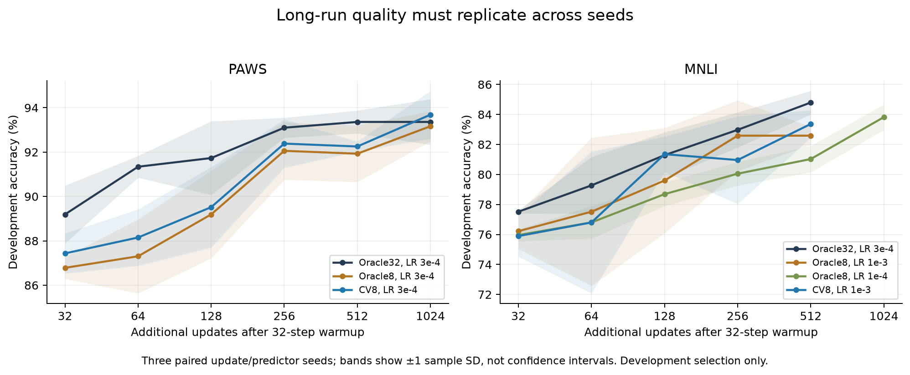

# Development evidence

These are **development-set** results used for exploration and selection. They are not the frozen final readouts. All steps are additional updates after the shared 32-step warmup. The complete positive and negative checkpoint inventory is [experiment_index.csv](results/experiment_index.csv).

## How much does the original predictor help?

Matched learning rate 0.0003, 256 updates; accuracy is the mean ± sample SD across three paired update/predictor seeds.

| Method | PAWS accuracy % | MNLI accuracy % |
|---|---:|---:|
| Oracle32 | 93.10 ± 0.45 | 82.98 ± 1.17 |
| Oracle16 | 93.16 ± 0.59 | 82.26 ± 0.58 |
| CV16 | 93.03 ± 0.79 | 82.91 ± 0.63 |
| Oracle8 | 92.06 ± 1.30 | 81.61 ± 1.07 |
| CV8 | 92.38 ± 1.09 | 81.87 ± 0.58 |
| Oracle4 | 89.32 ± 1.59 | 78.69 ± 1.66 |
| CV4 | 89.78 ± 0.96 | 79.60 ± 1.41 |

CV4 improves the small-subset estimate modestly, but it remains far from Oracle32. CV16 is much closer. Oracle16 is a particularly strong cheap control on PAWS. Independently tuned learning rates and stopping points are also considered in the frozen comparison.

## Did cheap adaptation of the predictor fix CV4?

| Attempt | Observed development result | Interpretation |
|---|---|---|
| PAWS head calibration every 8 updates | Best screened CV4: 90.82% at step 256; fixed CV4: 90.43%; Oracle32: 93.36% (same seed) | A small improvement, without closing the gap; this is the best of several single-seed trials |
| Residual-stream H refits | Best screened CV4 at step 256: PAWS 91.02%, MNLI 80.70% (one seed) | Some representation benefit, insufficient downstream improvement; fitting-label collection also differs from the Y baseline |
| Delayed correction coefficient | PAWS CV4 reaches 93.36% at step 512, using about 36.94 s of updates + 3.25 s preparation (one seed) | More updates can recover quality, but Oracle32 already reached 93.36% at step 256 in about 24.99 s |
| Class-only online RLS, k=8, LR 0.0003 | PAWS: 91.60% at 256, 93.10% at 512; MNLI: 81.68% at 256, 83.56% at 512 (three seeds) | Initial PAWS single-seed promise did not replicate at 256; 512-step quality needs a time-matched Oracle comparison |
| Stratified correction | PAWS k=4: CV 91.99% vs no-predictor 91.80%; MNLI: CV 79.53% vs no-predictor 80.90% (one seed, step 256) | Much of the benefit can come from sampling rather than prediction |
| Periodic anchors | PAWS period 2: predictor and no-predictor hold both 93.55% at step 256; MNLI period 4: predictor 81.68%, independently tuned hold 82.26% (one seed) | Reusing a true gradient is a necessary competing control |

These calibration schemes can reuse correction labels that were already paid for. Their disappointing quality does **not** imply that every form of adaptive calibration is intrinsically expensive. The inventory records calibration time separately.

The later three-seed PAWS period-2 replication gives **92.19%** for predictor anchors versus **92.32%** for no-predictor gradient hold at step 256, using the same learning rate of 0.0003. The promising seed-101 equality at 93.55% therefore does not establish a benefit from adding prediction. Both are retained in the frozen final comparison.

The final cached-body/head-calibration screen gives a direct cost check (one seed, CV4, update LR 0.0003, step 512; head calibration every step at LR 0.0003):

| Task | Frozen-head accuracy % | Calibrated-head accuracy % | Frozen updates + cache, s | Calibrated updates + cache, s |
|---|---:|---:|---:|---:|
| PAWS | 92.58 | 92.19 | 37.01 | 44.30 |
| MNLI | 80.90 | 80.31 | 37.43 | 44.58 |

The fitting component itself is only 2.16 / 2.12 seconds, but the complete online path also includes the extra work needed to retain calibration labels. A cheap fitting timer alone is not the total overhead. These development timings exclude inherited offline predictor preparation and are not final standalone speed claims. Cached-head calibration also fails to improve the MNLI CV8/CV16 screen at step 512.

## Did training on multiple model states help?

Four additional fits per task use Oracle32 teacher states 0/32/128/256, followed by CV4/CV8 trajectories through step 512. This is a single-update-seed screen, with a fixed learning rate of 0.0003.

- **PAWS:** the H128 multi-state fit reaches CV4 91.21% at step 256 versus 90.82% for its static-H128 control, then 91.41% versus 91.80% at step 512. Three of four fits select epoch 0 on predictor-development gradients, so their selected predictor does not benefit from the extra fitting.
- **MNLI:** the best screened multi-state CV4 at step 512 is 82.26%, versus 81.87% for the static-H128 control. The best multi-state CV8 is 83.04%, versus 83.24% for that control and 83.43% for the original fixed CV8 at the same LR/step. These small screened differences do not establish a gain.

The extra teacher trajectory, label collection and fitting must be charged. Multi-state supervision and explicit LoRA-state features did not establish a useful downstream improvement in this bounded screen. They also change fitting data/budget, so this is not a pure causal ablation of state coverage alone.

## Fewer full-gradient queries can fail late

Three-seed means at step 512, query probability q, delayed residual EMA coefficient 0.9:

| Task | q | Predictor accuracy % | Matched no-predictor accuracy % |
|---|---:|---:|---:|
| PAWS | 0.25 | 92.25 | 91.73 |
| PAWS | 0.50 | 93.03 | 92.77 |
| MNLI | 0.25 | 65.95 | 82.85 |
| MNLI | 0.50 | 83.37 | 83.37 |

MNLI predictor q=0.25, seed 103, fell from **79.34% at step 256 to 32.55% at step 512**. Thus early checkpoints alone can miss a serious failure. At q=0.5, the predictor adds cost while the replicated mean matches the simpler control. The estimator's raw-gradient unbiasedness does not prevent instability after clipping and Adam. See [query trajectories and clipping diagnostics](results/time_query_stability.json).

## Beyond 32 updates

The long screen records checkpoints 32/64/128/256/512/1024. It does not retain only each trajectory's best point.

On PAWS, replicated CV8 at step 1024 reaches **93.68 ± 1.08%**, compared with **93.36 ± 0.52%** for Oracle32 at step 512. Original exploration receipts give about **75.7 s** for CV8 updates plus cache versus **49.8 s** for Oracle32 updates. Matching quality at a later step is not automatically a speed improvement. Final execution costs use separate clean replays.

In the initial MNLI seed, Oracle32 (LR 0.0003) rises from 81.87% at step 256 to 85.58% at step 512, then falls to 83.04% at 1024. CV8 (LR 0.001) rises from 77.58% to 84.41%, then falls to 83.04%. Those observations motivated paired replications of the selected stopping points; they are not three-seed claims.

The subsequent **three-seed** MNLI means at step 512 are Oracle32 **84.80 ± 0.78%**, CV8 (LR 0.001) **83.37 ± 0.92%**, and matched Oracle8 **82.59 ± 0.60%**. CV8 improves on the same-subset control, but its 1.43-point gap to Oracle32 misses the development target. Class-only RLS8 reaches **83.56%** at this horizon, with about 35.4 seconds of online work and no offline fit (LR 0.001); it is retained as a distinct final candidate. The independently tuned Oracle8 at LR 0.0001 and step 1024 reaches **83.82 ± 0.85%**, but takes about 64.2 seconds, versus 55.5 seconds for the stronger Oracle32@512 in these exploration receipts.

Bands show ±1 sample SD across paired seeds, not confidence intervals. The [complete seed-101 screen](results/figures/long_curves_steps.png) retains the additional learning rates and methods. Replicated cohort statistics are in [development_cohorts.json](results/development_cohorts.json). See [setup and cost definitions](SETUP.md) before interpreting time comparisons.
