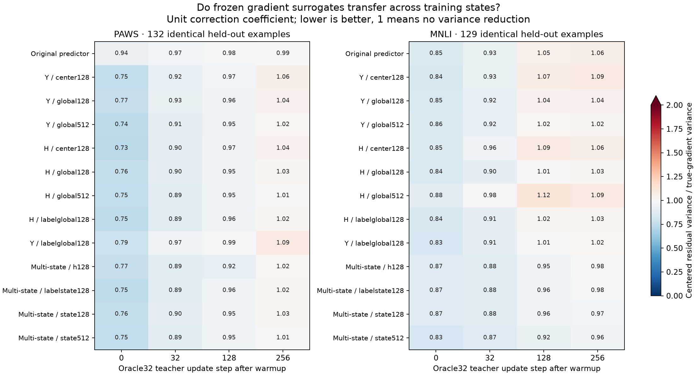

# What must improve for CV4 to become useful?

The relevant quantity is the **centered per-example residual variance**, rather than only the cosine similarity of an average gradient. A predictor can align with the average gradient while doing little to distinguish examples, giving little control-variate benefit.

For a fixed batch of N examples, uniformly sampling k correction examples without replacement gives

`E ||CV_mean − true_batch_mean||² = (1/k − 1/N) × S²(true − predicted)`.

Here S² is the sum of coordinate-wise sample variances, with denominator N−1. The same fixed-batch supervised-token normalization multiplies both methods equally. For N=32:

| Target raw-gradient sampling noise | Required residual / true variance | Required reduction |
|---|---:|---:|
| CV4 matches Oracle8 | ≤ 0.429 | ≥ 57.1% |
| CV4 matches Oracle16 | ≤ 0.143 | ≥ 85.7% |
| CV8 matches Oracle16 | ≤ 0.333 | ≥ 66.7% |

The fixed predictor currently shows only modest variance reduction on the small PAWS diagnostic sample, and some MNLI checkpoints have a ratio above one. This motivates changing the predictor representation and training-state coverage. Merely rescaling a weakly correlated predictor has limited potential.

These thresholds concern **raw-gradient sampling noise conditional on the same batch**. They do not guarantee downstream accuracy, and they do not describe the clipped Adam update. Oracle32 has no within-batch sampling error; matching its downstream performance can still be possible because learning tolerates some noise. Routine neural trajectory diagnostics use 16 held-out examples. The separate matched-state comparison uses all 132 PAWS / 129 MNLI gradient-test examples at each of four fixed teacher states; both are descriptive diagnostics, not downstream guarantees.

The finite-population formula is checked by enumerating every correction subset of an eight-example, five-dimensional toy population in `scripts/audit_cv_variance.py`; numerical results are in `results/cv_variance_audit.json`.

## Matched-state evidence

The original predictor's centered residual / true-gradient variance ratio on the full held-out gradient split is:

| Teacher updates after warmup | PAWS | MNLI |
|---:|---:|---:|
| 0 | 0.945 | 0.852 |
| 32 | 0.970 | 0.933 |
| 128 | 0.981 | 1.049 |
| 256 | 0.992 | 1.055 |

A ratio of 1 means no variance reduction; above 1 means that the unit-coefficient predictor increases sampling variance on this diagnostic population. Thus the original PAWS predictor removes about 5.5% of variance initially and less than 1% at teacher step 256. MNLI crosses above 1 after step 32.

Even fitting the best scalar coefficient **after seeing these diagnostic gradients** only lowers the step-256 ratios to 0.992 on PAWS and 0.978 on MNLI. Those coefficients are never used for training. This describes the limited potential of rescaling the original predictions at those states, not a deployable calibration result.

Multi-state fitting improves MNLI's late diagnostic ratio: the state512 model reaches 0.960 at teacher step 256. It still leaves about 96% of the raw variance and does not establish a downstream improvement. PAWS refits can improve the initial ratio substantially, but all tested refits are approximately 1 or above by teacher step 256.

All 13 predictors are compared against identical fresh gradient labels at each state. These are four states of one Oracle32 trajectory, not a claim about every possible CV trajectory or training distribution. The full [diagnostic CSV](results/surrogate_transfer.csv) includes separate LoRA-A/B results and post-hoc coefficients. Downstream generation and measured time remain the deciding evidence.

## Why fewer FLOPs did not translate directly into shorter time

The original optimized PAWS CV16 run, seed 101 at 256 updates, records **18.69 s** of online time: **16.74 s** in true-gradient label calls and **1.49 s** in prediction. These are component measurements from that development trajectory, not the final standalone benchmark. The [inventory](results/experiment_index.csv) includes the measured cumulative components; unmeasured components remain blank.

Reducing predictor inference alone therefore has limited room to help that implementation. Skipping entire true-gradient calls can save more time, but the random-query experiments show that a weak late-stage surrogate can make this unstable or add little over no-predictor gradient reuse. The next surrogate needs both better residual prediction across states and a cheaper complete update path.

## Why test the full residual-stream input?

At the trainable attention projection, let `Y` be its output and `R` the residual connection. The remaining network receives `H = R + Y`. The original predictor receives `Y`, so it does not directly receive everything used by the remaining network.

In this single-trainable-projection setup, the suffix is frozen. In exact arithmetic, its loss is a fixed function of `H`, the targets, and the masks/positions; the gradient with respect to `Y` equals the gradient with respect to `H`. This gives a specific reason to test **H plus label information** as the surrogate input. Training across several model states then addresses the changing distribution of H during adaptation. Explicit LoRA-state features may help the approximation, but full H already contains the LoRA change that reaches the frozen suffix.

This architectural argument motivates the experiment; it does not establish that a small predictor with the available training data can learn the required derivative accurately. Downstream accuracy and measured time remain the deciding tests.

The implemented surrogate stores H in BF16, so the exact-arithmetic information argument does not imply a lossless numerical representation. The explicit-state variants additionally supply the LoRA-induced change in FP32. Whether this materially improves prediction is an empirical question; input completeness alone is not evidence of a useful surrogate.
