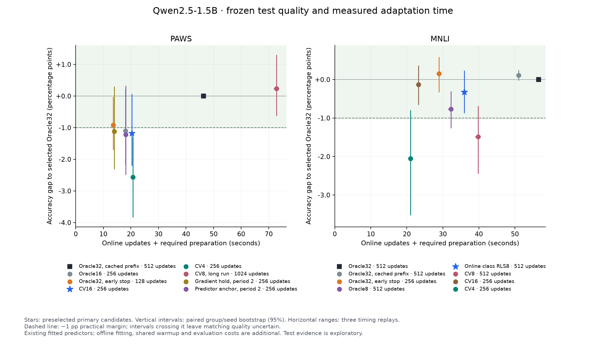

# Can a LoRA-gradient predictor match Oracle quality faster?

**Nine-hour budget, October 14, 2026. Qwen2.5-1.5B-Instruct; PAWS and MNLI; one H200.** Only layer 8's attention output projection is trained, using rank-64 LoRA. All update counts are additional to a shared 32-step warmup. This study adds no 0.5B/7B results; see the [earlier model/task overview](../experiment_overview_20261013/README.md).

**CV4 did not reach the target.** Online class RLS8 approaches the selected Oracle32 on MNLI without an offline predictor fit. Neural CV16 is another close MNLI result, but its fitted predictor has a separate preparation cost. PAWS's primary CV16 falls short; a longer CV8 trajectory recovers quality. The timing comparison and cheap Oracle controls determine whether these are useful accelerations.

| Task | Method · additional updates | Test accuracy % | Updates + prep, s | Standalone script, s |
|---|---|---:|---:|---:|
| PAWS | Oracle32, cached · 512 | 89.79 | 46.30 | 55.23 |
| PAWS | Oracle32, early stop · 128 | 88.87 | 13.54 | 22.30 |
| PAWS | Gradient hold, period 2 · 256 | 88.67 | 14.02 | 22.47 |
| PAWS | **CV16 (primary)** · 256 | 88.61 | 20.35 | 29.22 |
| PAWS | CV4 · 256 | 87.22 | 20.69 | 29.53 |
| PAWS | CV8, long run · 1024 | 90.02 | 72.85 | 82.32 |
| MNLI | Oracle32 · 512 | 84.82 | 56.57 | 65.66 |
| MNLI | Oracle32, cached · 512 | 84.92 | 51.06 | 60.33 |
| MNLI | Oracle32, early stop · 256 | 84.97 | 28.93 | 37.95 |
| MNLI | **Online RLS8 (primary)** · 512 | 84.49 | 35.95 | 44.98 |
| MNLI | CV16 (secondary) · 256 | 84.68 | 23.20 | 32.17 |
| MNLI | CV4 · 256 | 82.76 | 20.98 | 29.73 |

Times are medians of **three clean replays per cohort; all 48 replayed adapters match the evaluated weights bitwise**. Updates + prep includes required cache/initialization. Standalone adds imports, loading and final saving. Both exclude shared warmup, evaluation and offline predictor fitting. Recorded neural-predictor preparation adds **85.11 s on PAWS / 110.26 s on MNLI** on average; these historical components are not a newly measured cold pipeline. RLS8 requires no offline fit.

Accuracy is the three-seed mean on all **8,000 PAWS / 9,815 MNLI** evaluation examples. Warmup alone scores **84.39% / 78.24%**. Input prompts are preserved in full; 256 caps newly generated output only. Recipes, learning rates, stopping points, primary identities and adapter hashes were frozen before these readouts.

The preselected **PAWS CV16** misses the one-point target: gap **−1.18 pp [−2.21, +0.06]**. **MNLI RLS8** gives **−0.33 pp [−0.87, +0.23]**, within the descriptive margin. The smaller confirmation intervals cross −1 for both. Intervals resample paired seeds and source groups, conditional on one warmup. These evaluation populations were inspected in older studies, so the evidence is exploratory.

The practical time-to-quality findings are:

- **MNLI CV16:** about **20% less adaptation time / 15% less standalone time** than early-stopped Oracle32, with a −0.28-point test gap; counted matrix arithmetic is **3.55 vs 6.50 PFLOPs**. The supplementary paired interval is [−0.82, +0.26]; this direct secondary comparison was added after readouts and is exploratory. It is a useful **ready-predictor** operating point, without an established cold-start saving.
- **MNLI RLS8:** about **36% less adaptation time** than the 512-step Oracle32, with no offline fit. Early-stopped Oracle32 has a higher mean accuracy and is faster. Its added benefit over matched Oracle8 remains uncertain.
- **PAWS:** early-stopped Oracle32 is faster and has a higher mean accuracy than CV16. Long CV8 reaches Oracle quality, but takes **72.85 s versus 46.30 s**. It does not solve the time objective.

Matching-profile matrix FLOPs, all controls, confirmation results and uncertainty are in [the complete results](RESULTS.md). Fewer counted FLOPs alone do not establish lower wall time.

The search includes **525 development trajectories and 2,347 generated-accuracy readouts**, counting seed, hyperparameter and backend variants. Calibration, refits, online surrogates, gradient reuse and 1,024-step trajectories are documented, including failures and deferred grids. [All attempts](DEVELOPMENT.md) · [Method definitions](METHODS.md).

A key measured weakness is late-state residual prediction: the original predictor's centered residual/true-gradient variance ratio at teacher step 256 is **0.992 on PAWS / 1.055 on MNLI**; 1 means no variance reduction. Multi-state fitting and cheap head calibration did not establish a downstream rescue of CV4. Some low-query variants collapse late. The proposed next step is a compact residual predictor tested on unseen late states and actual time-to-quality. [Evidence and cost breakdown](DIAGNOSIS.md) · [Proposed follow-ups](NEXT_STEPS.md).

[All final results, intervals, timings and FLOPs](RESULTS.md) · [Exact setup and cost definitions](SETUP.md) · [CSV](results/final_comparison.csv) · [Reproduction](REPRODUCE.md) · [Source and configurations](../../predictor/cv4_effectiveness_9h_20261014/)
