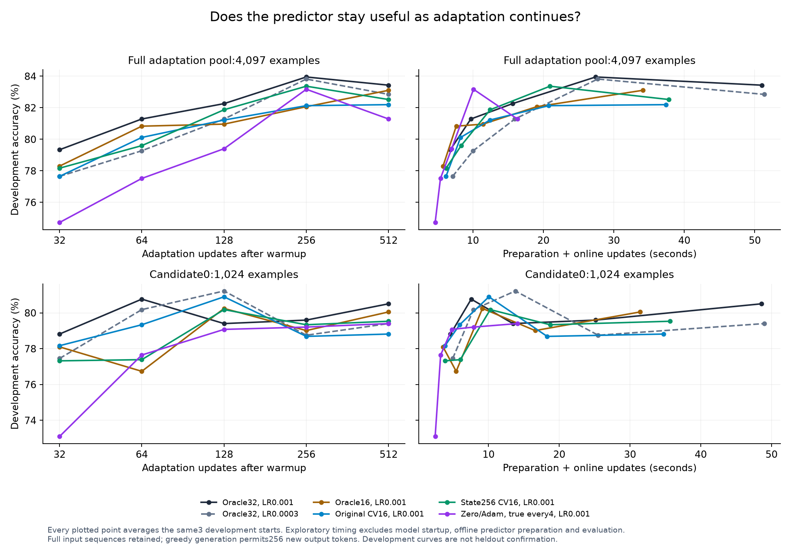
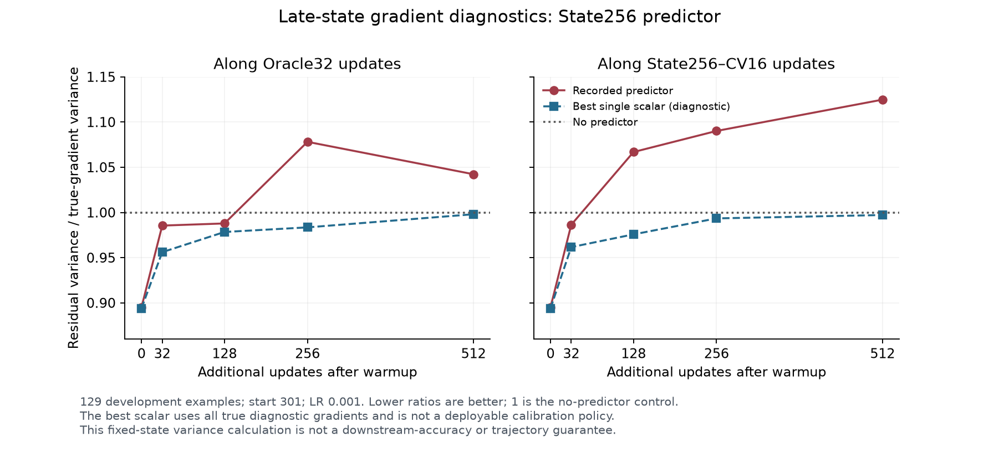

# Development evidence — not heldout confirmation

All averages below use starts 301/311/321 and the same 513 development examples. Times are recorded prefix/preparation plus online-update components. They exclude model startup, offline predictor construction and evaluation. Recipes and stopping points were inspected repeatedly; the final frozen study provides the separate confirmation.

## Full adaptation pool:4,097 examples

| Method | Additional updates | LR | Mean accuracy | Prep + updates |
|---|---:|---:|---:|---:|
| Warmup only | 0 | — | 75.24% | 0 additional s |
| Oracle32, best native-grid development quality | 256 | 0.001 | 83.95% | 27.43s |
| Short Oracle32 | 128 | 0.001 | 82.26% | 15.63s |
| Oracle16, matched | 256 | 0.001 | 82.07% | 19.06s |
| Original CV16 | 256 | 0.001 | 82.13% | 20.76s |
| State256 CV16 | 256 | 0.001 | 83.37% | 20.94s |
| Zero gradient / Adam momentum, true gradient every 4 updates | 256 | 0.001 | 83.17% | 10.08s |
| Oracle16, independently tuned | 512 | 0.0003 | 83.30% | 33.90s |

State256 improves over original CV16 by 1.23 percentage points on average, with a positive difference at each of these three development starts. It remains 0.58 points below the selected native Oracle32 and is much slower than the zero-gradient/momentum control for only 0.19 points more mean accuracy. The initial84.99% single-start result should not be presented as the replicated result: the other two state256 accuracies are 81.68% and83.43%.

Longer adaptation does not fix the issue. At512 updates, mean accuracy is 83.43% for Oracle32,82.20% for original CV16,82.52% for state256 CV16 and81.29% for the zero-gradient/momentum control, all atLR 0.001. Corresponding update/preparation costs increase. The final study keeps long-horizon controls rather than reporting only the most favorable checkpoint.

Two further three-start confirmations clarify where the predictor helps:

| Recipe | Updates | Mean accuracy | Prep + updates |
|---|---:|---:|---:|
| Original CV16, independently best native recipe, LR 0.0003 | 512 | 83.50% | 37.46s |
| Original CV8, graph backend, LR 0.001 | 512 | 83.50% | 24.88s |
| Matched Oracle8, graph backend, LR 0.001 | 512 | 82.52% | 21.33s |
| Original CV4, graph backend, LR 0.0003 | 512 | 82.85% | 18.97s |
| Matched Oracle4, graph backend, LR 0.0003 | 512 | 81.35% | 15.88s |
| State256 CV16 for 32 updates, then Oracle16, LR 0.001 | 256 | 83.37% | 20.03s |
| Warmup-only position template CV4, graph backend, LR 0.001 | 512 | 82.78% | 18.49s |
| Multi-state position template CV8, graph backend, LR 0.001 | 512 | 83.04% | 24.63s |

CV4 and CV8 improve over their matched small-subset teacher controls at all three starts. CV8 matches independently tuned original CV16's development mean at lower cost, but saves only about 2.55s versus the best native Oracle32 reference and still requires predictor preparation. The cheaper zero-gradient control remains essential. The early state256 cutoff matches full state256's256-update mean while saving about 0.91s; all first 32 adapter weights are exactly equal to the corresponding full-CV trajectories, and later updates perform no predictor inference. This supports testing an early-use recipe, not claiming long-horizon independent prediction.

The same early-cutoff policy with the original predictor reaches 82.20% at 256 updates/20.30s and82.13% at 512/35.52s. The warmup-only template reaches 82.91% at 256/19.95s and83.04% at 512/35.09s. Thus the state256 early result is not reproduced by simply stopping the original predictor after 32 updates. These are development comparisons, not proof of a causal mechanism or a general benefit from early cutoff.

The graph Oracle32/LR 0.0003/256 recipe reaches 84.21%/30.72s in this development screen; the frozen practical reference remains the independently selected, faster native Oracle32 grid point83.95%/27.43s. “Selected Oracle” does not mean a globally optimal Oracle across every implementation or untested configuration.

The template's initial84.99% point does not replicate as a three-start mean. On candidate0, the multi-state CV8 template reaches 79.79% at 512 updates/21.69s, while the warmup-only CV4 template reaches 79.86%/16.18s. Neither improves over the original CV16 candidate reference80.90%/10.05s. This is a concrete failure to transfer the apparent fullpool advantage to smaller training subsets.

## Candidate0:1,024 examples

| Method | Additional updates | LR | Mean accuracy | Prep + updates |
|---|---:|---:|---:|---:|
| Oracle32, best native-grid development quality | 128 | 0.0003 | 81.22% | 13.79s |
| Oracle32, shorter efficiency control | 64 | 0.001 | 80.77% | 7.56s |
| Original CV16, selected shorter checkpoint | 128 | 0.001 | 80.90% | 10.05s |
| Oracle16, same true-gradient count as CV16 | 128 | 0.001 | 80.25% | 9.14s |
| Zero gradient / Adam momentum, true every 4 | 256 | 0.0003 | 80.31% | 7.93s |
| State128 CV16, best development quality | 256 | 0.0003 | 80.96% | 19.15s |
| State256 CV16, best development quality | 256 | 0.0003 | 80.90% | 18.65s |
| Oracle16, independently tuned | 256 | 0.0003 | 80.57% | 16.60s |

Oracle32×64, CV16×128, Oracle16×128 and the periodic-true-gradient256-update control each compute2,048 true training-example gradients, counting repeated examples. Their update counts, data visitation, optimizer states and learning rates are not identical. This comparison isolates a useful compute budget; it is not a same-trajectory experiment.

Original CV16 at 128 updates is close to the selected native Oracle's mean accuracy, but the 64-update Oracle already reaches nearly the same quality sooner. Neither new explicit-state model improves this development accuracy/time frontier. A claim of practical predictor acceleration must survive these shorter Oracle controls and include offline costs.

## Why predictions weaken after warmup

A separate read-only audit collects true gradients on the 129 predictor-development examples along existing Oracle/CV trajectories. For state256 atLR 0.001:

| State | Centered residual variance / true-gradient variance |
|---|---:|
| Initial warmup | 0.895 |
| Oracle after 32 updates | 0.985 |
| Oracle after 256 updates | 1.078 |
| Oracle after 512 updates | 1.042 |
| State256-CV16 after 256 updates | 1.090 |
| State256-CV16 after 512 updates | 1.125 |

A ratio above 1 means the residual gradients have greater empirical variance than the true gradients across these 129 diagnostic examples. For uniform subsampling from this fixed empirical population, that corresponds to greater raw correction variance than a zero-predictor/true-subset estimate. It is a proxy, not a direct measurement of every actual32-example training batch, and it does not mathematically determine downstream accuracy after clipping and Adam. Batch-mean error and mean-gradient alignment also deteriorate; the full audit reports both.

A posthoc CPU calculation tests whether simply rescaling the prediction could repair this diagnostic. For centered true/predicted gradient matrices, the best unrestricted single scalar leaves residual ratio `1 − correlation²`. For state256 on Oracle256/512, that best possible ratio is **0.9835 / 0.9980**; on its own CV256/512 states it is **0.9934 / 0.9971**. Thus an ideal scalar fitted using all true diagnostic gradients could remove the excess variance, but only reduce it by about **0.2–1.7%** below the zero-predictor control at these late states. This is not a deployable coefficient, a downstream-performance bound, or a claim about richer conditional calibration. It suggests that global rescaling alone has limited late-state variance-reduction potential. [All 39 diagnostic rows](results/scalar_cv_diagnostic.json).

The deterioration appears on Oracle trajectories too. The registered threshold for an additional CV-specific/on-policy refit was not met at two later checkpoints. Instead, a bounded coverage ablation adds high-LR Oracle states through 512 updates to the original lower-LR state collection, keeping the same state256 architecture and unique fitting examples. Its additional collection, trajectory and fitting costs remain explicit. Completed mean-aware fitting, sparse calibration and copied-teacher-suffix experiments test other explanations; results are below.

The completed coverage fit uses exactly the same 15,840 optimizer steps as the original state256 fit, with 12 rather than 8 teacher states. On the same diagnostic gradients, the centered ratio improves from 1.078 to0.973 at Oracle256, from 1.108 to0.991 at original-CV16's256-step state, and from 1.090 to1.002 at state256-CV16's256-step state. At512 it remains approximately 1.001–1.016. Expected batch32 mean-error ratios improve too but remain above 1. These are development diagnostics, including states used for fitting/selection; they are not heldout transfer or downstream gains. The coverage rollout readout is separate.

## Additional completed attempts

These single-start screens use start301 and the full pool unless otherwise stated. They were exploratory and were not promoted to final methods.

| Attempt | Representative outcome | Interpretation |
|---|---|---|
| Batch-mean-aware state fitting | Pure updates at LR 0.00003:31.97% with mean-loss weight0,0% with weight4; CV16 at 256:83.43% and82.85% | Better selected batch-error metrics did not rescue autonomous gradient rollout. |
| Sparse adaptive calibration using already-paid correction labels | CV16 head calibration every 16 at 512:83.24%/40.70s; original CV16 at this start:83.43%/~37.4s | No clear quality/time improvement across the ten screened schedules. |
| Copied two-block teacher suffix, Sobolev + distillation | CV16 at 256:83.24%/28.66s; pure updates 45.42% at LR 0.0003 | Larger, structured surrogate remains slower and needs true-gradient correction. |
| Copied suffix, distillation only | Pure updates at 256:73.10%/16.11s at LR 0.0003; CV16:82.26%/29.28s at LR 0.001 | Less catastrophic pure rollout than several smaller predictors, but below warmup and corrected baselines. |
| Full-data gradient-table control variate, candidate0 | Best factor4 point81.48%/18.47s at 512 versus short matched-IID Oracle81.29%/15.22s at 128 | No practical time frontier improvement. |
| High-LR state coverage | State256 CV16 at 256:84.02% versus original state model84.99% for this start | Stronger gradient diagnostics did not translate into a better downstream point. |

Copied-suffix pure updates use a restricted answer-token objective; its failures cannot be attributed solely to model capacity or depth. All unreported grid cells remain in the experiment inventory. Generation-cap hits are tracked separately from input lengths; evaluation prompts are never truncated.

## Additional data and capacity after the final freeze

A separate three-start development ablation expands the state predictor from 512 to 2,048 distinct fitting inputs at matched total example-state visits, then tests width 512. More data improves the early-use 512-step mean from 83.24% to 83.95%, but takes 34.0s versus the existing Oracle32's 83.95%/27.4s. Larger capacity does not provide a consistent improvement. These outcomes do not replace any frozen final method. [All seven policies, fitting costs, diagnostics and the subsequent distillation readout](LATE_DEVELOPMENT.md).

## Predicting the agent's behavior

The original direct behavior MLPs reach only 37–41% mean accuracy on their 129-example predictor-development readout, despite the teacher being substantially better. A bounded anchored variant retains the initial teacher's exact ABC logits and learns only their change. Its selected 64-wide network reduces the common normalized logit-plus-state-change error from 1.117 for unchanged initial logits to0.794. This fitting objective improves, but actual behavior prediction remains weak.

The separate513-example pilot covers starts 301/311/321 and39 warmup/updated adapters. All warmup predictions exactly reproduce the paid initial teacher readout. For Oracle32/LR 0.001 trajectories:

| Additional updates | Exact current teacher accuracy | Anchored surrogate accuracy | Unchanged initial teacher accuracy | Surrogate agreement with current teacher | Initial teacher agreement with current teacher |
|---|---:|---:|---:|---:|---:|
| 32 | 78.88% | 73.88% | 75.50% | 86.16% | 87.52% |
| 128 | 82.20% | 74.33% | 75.50% | 82.39% | 85.32% |
| 256 | 84.15% | 74.72% | 75.50% | 82.52% | 83.11% |
| 512 | 83.37% | 75.11% | 75.50% | 82.26% | 82.33% |

These are forced-format ABC results, not generated-answer accuracy. The surrogate generally fails to capture the teacher's improvement and does not beat unchanged initial behavior on class agreement in this Oracle pilot. Its approximately 0.10s per-adapter readout is cheaper than the exact teacher's0.69s, but the shared prefix cache and one initial-teacher readout are additional. Lower inference cost alone is insufficient. The separate frozen candidate-ranking tests examine whether small score changes contain useful selection information despite this weak direct fidelity; their completed results are in RESULTS.md. Full fit metrics, CV trajectories and per-start results are retained in `results/behavior_development_summary.json`.

The same architectures were subsequently fitted with four additional late/higher-LR Oracle states. A common 12-state rescoring of all eight candidates selects anchored128 with expanded coverage: joint error0.938 versus 0.994 for the original anchored128 and1.168 for unchanged initial logits. On the separate three-start Oracle256 pilot, its mean accuracy is 74.85% versus the current teacher's84.15% and the initial teacher's75.50%; class agreement is 82.91% versus 83.11% for unchanged initial logits. Better logit error still does not establish reliable prediction of the agent's changed decisions.

## Engineering controls

CUDA Graph and matching eager-static execution passed exact final-weight checks through 512 updates. Independent eager FLOP profiling also matched graph counts after accounting for actually executed capture warmups/audits. Native versus padded static execution remains a separate numerical/quality comparison; graph improvements are available to true-gradient controls too.

One development evaluation completed all 30 readouts, then a resource guard mistook its own exiting vLLM worker for an unknown GPU process after that worker's environment disappeared. The original nonzero stage result is retained. A fresh-generation replay completed cleanly and reproduced all 15,390 per-example records exactly. The guard now retains only previously verified PID/start identities during teardown; unknown or reused process identities remain rejected.

The first complete selection-workflow timing attempt reproduced all five adapters, generated records and the frozen choice, then failed while looking up a candidate Oracle override that the frozen specification intentionally leaves at its default. The workflow and cost-ledger readers now use the same default/override rule as the unchanged frozen analysis. All 33 reference populations and 2,340 cost decisions passed reconciliation. A fresh whole-workflow rerun passed; the failed partial timer is excluded from qualified timing and retained as research overhead.

Complete cells, individual starts, recipes and timings are in `results/candidate_confirmation_summary.*`, `results/fullpool_confirmation_summary.*` and `results/reuse_experiment_index.csv`. Unevaluated exploratory points remain blank rather than being reported as measured failures.
