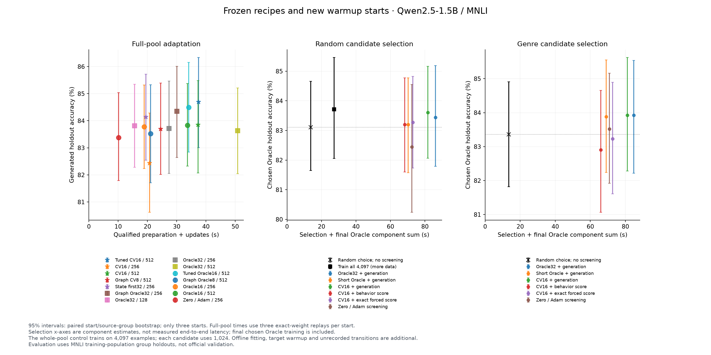

# LoRA gradient predictors as reusable training surrogates

**Hybrid predictor updates can approach Oracle accuracy, but this study does not establish an overall predictor efficiency win.** Shorter Oracle training and cheap true-gradient controls remain competitive. The separate behavior surrogate does not yet capture the trained agent's improvement.

## Direct training

Qwen2.5-1.5B-Instruct, MNLI, one H200. Generated accuracy averages **three new starts on 2,049 heldout examples**. Updates are additional to a shared 32-update warmup. Each time averages the three starts' medians from **three exact-weight timing repetitions**.

| Method | Updates | LR | Accuracy % | Prep + updates, s | Fresh process, s |
|---|---:|---:|---:|---:|---:|
| Warmup only | 0 | — | 77.45 | 0 incremental | 0 incremental |
| Short Oracle32 | 128 | 0.001 | 83.81 | 15.61 | 24.08 |
| Primary Oracle32 | 256 | 0.001 | 83.72 | 27.38 | 36.09 |
| Stronger Oracle32, graph | 256 | 0.0003 | 84.35 | 30.06 | 39.00 |
| Matched Oracle16 | 256 | 0.001 | 83.78 | 18.86 | 27.51 |
| Original CV16 | 256 | 0.001 | 82.43 | 20.76 | 29.27 |
| State CV16 first 32, then Oracle16 | 256 | 0.001 | 84.14 | 19.46 | 28.03 |
| Tuned original CV16 | 512 | 0.0003 | 84.69 | 37.44 | 46.19 |
| Tuned Oracle16 | 512 | 0.0003 | 84.50 | 34.13 | 42.89 |
| Original CV8, graph | 512 | 0.001 | 83.70 | 24.54 | 33.54 |
| Matched Oracle8, graph | 512 | 0.001 | 83.52 | 21.11 | 30.03 |
| Zero / Adam, true gradient every 4 | 256 | 0.001 | 83.37 | 10.17 | 18.62 |

Times exclude shared target warmup, evaluation and offline predictor construction. Fresh-process time additionally includes imports/loading and final save. Recorded offline construction is **124.0s** for the original predictor and **488.8s** for State256, including source warmups/dependencies; these are historical component totals, not clean cold-start benchmarks. Reuse spreads construction cost but does not remove per-update predictor overhead. [All horizons, matrix FLOPs, costs and intervals](RESULTS.md).

**Fewer FLOPs need not mean less time:** on representative candidate0, CV16/128 costs **1.40 matrix PFLOPs / 10.20s**, versus short Oracle32/64's **1.48 PFLOPs / 7.76s**. FLOPs use start 302; times average all three starts' medians.

The early state-predictor recipe improves over original CV16/256 by **+1.71 pp [+0.26, +3.34]**, but its difference from matched Oracle16 is **+0.36 pp [-0.30, +0.95]** and from the stronger graph Oracle32 is **-0.21 pp [-1.04, +0.59]**. These paired 95% intervals do not establish superiority or noninferiority to Oracle. The recipe changes both fitting and the duration of predictor use.

## Selecting training data

Screen five 1,024-example datasets on selection-dev, then deploy the **reference Oracle trained on the chosen dataset**. These are its heldout accuracies, not the simulator adapter's accuracy. Simulations use 128 updates, except short Oracle's 64; the reference is Oracle32/128/LR 0.0003.

| Screening method | Random candidates % | Genre candidates % |
|---|---:|---:|
| Oracle / generated accuracy | 83.44 | 83.93 |
| Oracle / exact teacher probability | 83.65 | 83.94 |
| Short Oracle / exact teacher probability | 83.29 | 83.75 |
| CV16 / generated accuracy | 83.60 | 83.93 |
| CV16 / exact teacher probability | 83.28 | 83.23 |
| CV16 / learned behavior probability | 83.20 | 82.90 |
| Random choice, expectation | 83.11 | 83.36 |

CV16/generated scoring gains **+0.49 pp [-0.14, +1.09]** over random choice on random candidates and **+0.57 pp [-0.33, +1.43]** on genre candidates. Neither establishes a selection advantage over random choice.

The actual complete-workflow benchmark below uses **start 302, five random candidates and three timing repeats**. It charges fresh adaptations, scoring, process transitions/loading and final Oracle training when needed; exhaustive Oracle selection reuses its chosen adapter. Offline construction and common warmup remain additional.

| Complete workflow | Median seconds | Offline construction components, s |
|---|---:|---:|
| Oracle32 + generation | 152.15 | 0.0 |
| Oracle32 + exact ABC score | 132.05 | 0.0 |
| CV16 + generation | 157.93 | 124.0 |
| CV16 + exact ABC score | 136.56 | 124.0 |
| CV16 + learned behavior score | 133.65 | 330.9 |
| Short Oracle32 + exact ABC score | 123.93 | 0.0 |

This implementation uses separate processes, not a persistent model server. Timing repeats are not independent scientific starts. Keeping the selected simulator adapter avoids final Oracle training, but changes the deployment endpoint; those frozen secondary quality results and component costs are separate in [RESULTS](RESULTS.md).

## What the surrogate learned

For the primary Oracle32/256 agent, forced-format ABC accuracy is **83.72%**; the learned behavior model reaches **76.96%**, versus **77.62%** for unchanged initial predictions. Its agreement gain with the changed agent is **-1.07 pp [-3.39, +0.85]**. Cheap inference alone has not produced a reliable behavior replacement.

Late-state gradient correlation also weakens. State conditioning, additional state coverage, mean-aware fitting, sparse calibration, scalar/token critics, copied teacher blocks, gradient memory and local linearization were tested during development. [Attempt-by-attempt evidence and failures](DEVELOPMENT.md).

## Setup and interpretation

- Only decoder layer index 8 (ninth block), attention output-projection LoRA is trained: rank/alpha 64; fresh AdamW state after warmup, batch 32, clipping 1, no weight decay.
- Final warmup/update seeds: 302/401, 303/402, 304/403. Fullpool adaptation uses 4,097 examples. Five random candidates may overlap; five genre candidates use disjoint source groups.
- Selection-dev: 1,026 examples; holdout: 2,049. Recipes precede selection-dev results; choices precede holdout results. These are **MNLI training-population holdouts**, not the official validation benchmark. No new 0.5B, 7B or PAWS result is claimed.
- All evaluation inputs are preserved. Greedy generation permits at most 256 **new output tokens**. Forced ABC scores are a separate metric.
- **Oracle16/8** uses a true-gradient subset without a predictor. **CV16/8** predicts all 32 gradients and corrects with 16/8 true gradients. State256 names predictor width; its early-use recipe switches to Oracle16 after 32 updates. [Method definitions](METHODS.md).

**Next priority:** beat short Oracle at equal total time. For gradient prediction, first improve late-state correlation on new starts. For Ben's data-selection use case, test a model that predicts which dataset yields a larger improvement; reconstructing every changed-agent logit may be unnecessary. That ranking model remains future work and must beat random selection and cheap Oracle controls with its construction cost charged.

[Protocol](PROTOCOL.md) · [Literature](LITERATURE.md) · [Reproduction](REPRODUCING.md) · [Complete numerical results](RESULTS.md)
